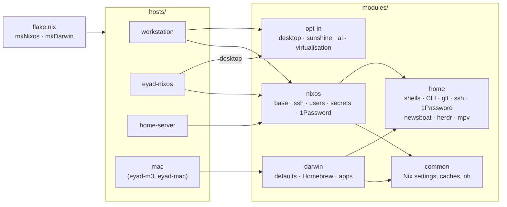

<div align="center">

# ❄️ dotfiles

**Every machine I own, in one flake.**

NixOS on the desk and the laptop, nix-darwin on the Macs, Home Manager underneath all of
them. About 2,200 lines of Nix, and every setting lives in exactly one place.

[](https://github.com/eyadsibai/dotfiles/actions/workflows/check.yml)
[](https://nixos.org)
[](https://github.com/nix-darwin/nix-darwin)
[](https://github.com/olafkfreund/nixarchy)
[](#keys-live-in-1password)

</div>

---

## What this is

My personal configuration, not a framework. It describes a desktop I mostly use from
somewhere else, a ThinkPad, two Macs, and a home server that doesn't exist yet. Everything
in here is something I actually run; the generic parts are deliberately thin, and the
specific parts are commented with the reason, because I will have forgotten it in a year.

The desktop is [Omarchy](https://omarchy.org), the same one as on my Arch machines, brought
to NixOS by [nixarchy](https://github.com/olafkfreund/nixarchy). Same Hyprland keybinds,
same bar, same Tokyo Night everywhere.

## The machines

| Host | What it is | Notes |
|---|---|---|
| `workstation` | NixOS · Intel + RTX 4090 | The main machine. Logs in at boot and locks itself, never sleeps, streams to the Macs over Sunshine, runs Ollama on the GPU and the Docker/libvirt stack. Used over Tailscale as much as at the desk. |
| `eyad-nixos` | NixOS · AMD ThinkPad | Same Omarchy desktop, plus the laptop quirks (kernel params this ThinkPad needed, power-profiles-daemon, trackpoint). |
| `eyad-m3`, `eyad-mac` | macOS · Apple Silicon | One configuration, two names. macOS defaults, Homebrew casks managed declaratively, a Linux builder VM, Rosetta. |
| `home-server` | NixOS | A skeleton with placeholder hardware, waiting to replace the Unraid box. |

Two more machines run Omarchy on Arch (`vector`, `cachy`). They're not managed here yet;
Omarchy manages them well enough on its own.

## How it's put together



```
flake.nix          inputs, mkNixos / mkDarwin, the hosts, checks, dev shell
hosts/<name>/      hardware and what that machine is for; nothing shared lives here
modules/common/    Nix itself: caches, GC, nh, trusted users (both platforms)
modules/nixos/     every NixOS host gets default.nix; desktop, sunshine, ai and
                   virtualisation are opt-in by import
modules/darwin/    macOS defaults, Homebrew, Mac-only apps
modules/home/      Home Manager for every machine: shells, CLI, git, ssh, 1Password,
                   newsboat, herdr, mpv; firefox and the GUI apps only on Linux desktops
secrets/           sops-encrypted, recipients in .sops.yaml
```

The one rule: **a setting has one home.** Anything needing root, hardware or a daemon goes
in `modules/nixos` or `modules/darwin`; everything else goes in Home Manager so every
machine gets it. A host file only says what makes that machine different. Optional
features are modules you import, and the few custom options live under `my.*`
(currently just `my.desktop.autoLogin`).

## Decisions, and why

The parts of this repo that aren't obvious from the code.

- **Omarchy through nixarchy, pinned to a release tag.** I wanted the same desktop on NixOS
  and Arch, not a hand-rolled Hyprland. nixarchy is one maintainer's project, so it's pinned
  and bumped on purpose, after trying it in `just vm` and after the Arch machines are on
  the same Omarchy version.
- **Hyprland comes from nixpkgs, not nixarchy's hyprwm input.** Only `cache.nixos.org`,
  the nix-community cache and the CUDA cache are trusted. nixarchy's own bits are small
  and build locally; a compositor is not.
- **No GNOME. Nothing left of it but gnome-keyring.** The workstation ran GNOME + xrdp for
  years. It's gone, along with GDM and gnome-remote-desktop.
- **greetd autologin, then lock immediately.** The workstation is used remotely as often as
  not. After a reboot, Sunshine and gliff need a session to attach to, so the first session
  of each boot logs in by itself and `hyprlock`s within a second. Later logins go through
  the greeter normally.
- **Sleep is disabled at the systemd level,** not just in the idle settings. A remote
  machine that suspends is a brick.
- **Closed NVIDIA driver, LTS kernel.** The 4090 works with the open modules too, but the
  closed driver is what this machine has always run, and nixarchy's default of the newest
  kernel is one more thing to break on a machine I fix over SSH.
- **CUDA per package, never globally.** `nixpkgs.config.cudaSupport = true` only ever rebuilt
  Firefox and btop. Ollama gets `ollama-cuda`; btop gets an override.
- **Small models local, big models elsewhere.** Ollama and LM Studio on the 4090 for the
  small stuff; the heavy models run on a DGX Spark on the tailnet.
- **`nh` instead of `nix.gc`.** `nh os switch` shows the package diff before activating,
  and `nh clean` keeps the last 10 generations and 7 days. Same on both platforms.
- **A cache mirror in front of cache.nixos.org.** The CDN route from home caps at ~1 MB/s;
  the mirror does 3–4× that, serves the same signed files, and trusts nothing new.
- **Homebrew with `cleanup = "zap"`.** On the Macs, anything not in `homebrew.nix` is
  removed on the next switch. The list *is* the Mac.
- **devenv for projects, not the machine.** Toolchains live in each repo's `devenv.nix`;
  the system only ships `devenv` itself, direnv and the editors.

## Keys live in 1Password

There are no private keys on any of these disks. The SSH agent, git authentication and
commit signing all go through the 1Password app, with two wrinkles for a machine that's
used over SSH:

- **The right agent for the session.** At the desk, SSH asks the local 1Password. Over SSH
  with a forwarded agent (`ssh -A`), the forwarded one wins, so the approval prompt
  appears on the screen I'm actually looking at. Over SSH *without* one, it falls back to
  the local app rather than having no key at all. One `Match exec` rule in
  `modules/home/onepassword.nix` decides.
- **Signing follows the same logic.** `op-ssh-sign` only talks to the local app, so the
  signer is a tiny wrapper that uses the forwarded agent (plain `ssh-keygen -Y sign`) when
  there is one. Commits made over `ssh -A` get approved on the laptop I'm typing on.

Secrets for the system side use [sops-nix](https://github.com/Mic92/sops-nix): age keys
derived from each host's SSH host key, plus a personal key backed up in 1Password. A
machine decrypts its own secrets at activation, into RAM, never into the store.

## Things nixarchy didn't cover (yet)

Found while living on it; fixed here, reported upstream.

| Gap | Fix in this repo | Upstream |
|---|---|---|
| Chromium starts without Omarchy's bundled extensions (copy-url, yt-dlp, WhatsApp). Omarchy enables them through a flags file Arch's launcher reads and nixpkgs' doesn't. | Flags built into the Chromium the Omarchy package installs; the native-messaging hosts re-registered at every activation via a stable `/run/current-system` path. | [#1491](https://github.com/olafkfreund/nixarchy/issues/1491) |
| After an autologin boot the login keyring stays locked until some app asks for its password. | The lock screen's PAM service unlocks it (`enableGnomeKeyring`), so the first unlock after boot opens the keyring. Stays encrypted, unlike Omarchy's Arch default. | [#1492](https://github.com/olafkfreund/nixarchy/issues/1492) |
| Xournal++'s seeded config points its LaTeX template at `/usr/share`. | Not fixed; I don't use LaTeX insertion. | [#1493](https://github.com/olafkfreund/nixarchy/issues/1493) |

When these land upstream, the workarounds in `modules/nixos/desktop.nix` go.

## Day to day

Clone to `~/dev/dotfiles` (the path `nh` and Omarchy's Update menu expect), `direnv allow`
once for the dev shell, then:

| Command | Does |
|---|---|
| `just switch [host]` | build, show the package diff, activate (NixOS or macOS) |
| `just build [host]` | build and show the diff only |
| `just boot [host]` | NixOS: activate on next boot, for desktop or login changes |
| `just vm [host]` | NixOS: boot the exact configuration in a throwaway QEMU VM (no NVIDIA) |
| `just update [input]` | update all flake inputs, or one |
| `just check` | `nix flake check`: evaluates every host, checks formatting |
| `just clean` | drop old generations, GC the store |
| `just secret <name>` | edit `secrets/<name>.yaml` |

`host` defaults to the current machine. CI runs the same evaluation for all five hosts on
every push.

Small things I'd miss if they were gone, all in `modules/home/`:

- **newsboat** with 323 feeds and 495 YouTube channels (`newsboat-yt`), vim keys, and
  macros to send a link to mpv, yt-dlp or `download_arxiv`. The feed lists are plain files
  linked into `~/.config`, so `rssadd <url>` edits the repo.
- **herdr**, a tmux-style workspace manager for coding agents, with keys mirroring Omarchy's
  tmux config. Its config is linked from the repo too.
- **`x`** extracts any archive, **`wh`** tells you where a command really lives,
  **`getip`**, **`gitignore <lang>`**.
- About 40 git aliases carried over from years of dotfiles (`l3`, `today`, `undo`, `ours`/`theirs`,
  `cleanup-local`, `unfuck`), and `gh:owner/repo` as a clone URL.
- Firefox with its extensions installed through policies and years of privacy and
  telemetry prefs; mpv with the same h/j/k/l keys everywhere.

## When it breaks

Ten generations in the boot menu, `nh os rollback` over SSH, and `just vm` before anything
that touches the login path. The boot-menu editor is off on every host, so nobody at the
keyboard gets a root shell with `init=/bin/sh`.

## Lineage

This repo is the merge of three: a 2022 "dotfiles" flake (i3, X11, a different laptop), the
`nixconfig-workstation` repo that ran this desktop on GNOME, and `nix-darwin-config` for the
Macs. They were folded into one flake in October 2026, rebuilt around nixarchy, and the
history was rewritten the same week to scrub credentials that had been committed in 2022.
The old i3/X11 configs, the ranger and qutebrowser setups and the nixvim config are still in
the history if I ever want them back.

## Built on

[nixpkgs](https://github.com/NixOS/nixpkgs) ·
[Home Manager](https://github.com/nix-community/home-manager) ·
[nix-darwin](https://github.com/nix-darwin/nix-darwin) ·
[nixarchy](https://github.com/olafkfreund/nixarchy) /
[Omarchy](https://github.com/basecamp/omarchy) ·
[sops-nix](https://github.com/Mic92/sops-nix) ·
[nix-index-database](https://github.com/nix-community/nix-index-database) ·
[nixos-hardware](https://github.com/NixOS/nixos-hardware) ·
[nh](https://github.com/nix-community/nh)

<div align="center">
<sub>Not meant to be used as-is: the hostnames, keys and feeds are mine. Borrow anything.</sub>
</div>
