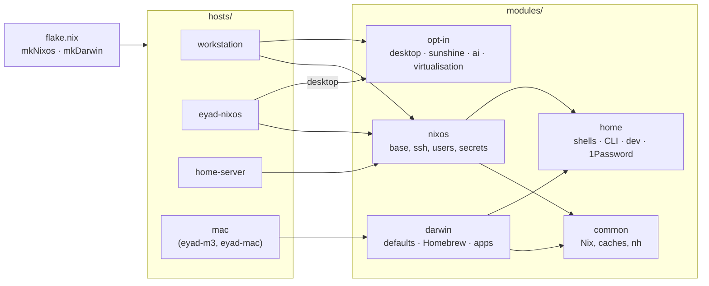

<div align="center">

# ❄️ dotfiles

**One flake. Every machine. Linux and macOS.**

Declarative NixOS, nix-darwin and Home Manager configuration for my workstation,
laptop, Macs and a future home server: about 1,600 lines of Nix, with each idea
written once.

[](https://github.com/eyadsibai/dotfiles/actions/workflows/check.yml)
[](https://nixos.org)
[](https://github.com/nix-darwin/nix-darwin)
[](https://github.com/nix-community/home-manager)
[](https://github.com/olafkfreund/nixarchy)

</div>

---

## ✨ Highlights

- **🖥️ One desktop everywhere.** [Omarchy](https://omarchy.org)'s Hyprland desktop on NixOS through
  [nixarchy](https://github.com/olafkfreund/nixarchy), built against nixpkgs' Hyprland so it comes
  from `cache.nixos.org` instead of being compiled locally. Tokyo Night throughout.
- **🔐 No private keys on disk.** SSH and commit signing go through the
  1Password agent on every machine. Secrets are sops-encrypted to age keys derived from
  each host's SSH key.
- **🛰️ Built for remote use.** The workstation logs in at boot and locks itself straight
  away, so it never sleeps and always has a session. Sunshine (NVENC) streams it to Moonlight on the Macs, over
  Tailscale only, and the machine doubles as a subnet router and exit node.
- **🧠 Local AI.** CUDA Ollama and LM Studio on the RTX 4090 for small models. CUDA is
  turned on per package rather than globally, so nothing else gets rebuilt.
- **🍎 Macs included.** nix-darwin with system defaults, Homebrew casks managed
  declaratively (`zap` removes anything unlisted), a Linux builder VM and Rosetta.
- **🧪 Safe to change.** `just vm` boots the workstation's exact configuration in a
  throwaway QEMU VM, and `nh` shows a package diff before anything activates. CI evaluates every host on every push.

## 🗺️ Machines

| Host | Platform | Role |
|---|---|---|
| `workstation` | NixOS · Intel + RTX 4090 | Main desktop: Omarchy, Sunshine, Ollama, Docker/libvirt. Used remotely as much as at the desk |
| `eyad-nixos` | NixOS · AMD ThinkPad | Laptop with the same Omarchy desktop |
| `home-server` | NixOS | Skeleton for the coming Unraid replacement |
| `eyad-m3`, `eyad-mac` | macOS · Apple Silicon | One shared configuration; only the hostname differs |

## 🧱 How it fits together



```
flake.nix          inputs, mkNixos / mkDarwin, every host, checks, dev shell
hosts/<name>/      hardware and the machine's purpose: nothing shared lives here
modules/common/    Nix settings for both platforms (caches, GC, nh)
modules/nixos/     default.nix for every NixOS host; desktop, sunshine, ai and
                   virtualisation are opt-in by import
modules/darwin/    macOS defaults, Homebrew, apps
modules/home/      Home Manager for every machine: shells, CLI, dev tools, 1Password
secrets/           sops-encrypted, recipients in .sops.yaml
```

### Principles

1. **Each setting has one home.** Shared settings live in a module, and a host file only
   says what makes that machine different.
2. **System vs user.** Anything that needs root, hardware or a daemon goes in
   `modules/nixos` or `modules/darwin`. Everything else goes in Home Manager so every
   machine gets it.
3. **Opt in by import.** Optional features are separate modules a host imports. The few
   custom options live under `my.*` (e.g. `my.desktop.autoLogin`).
4. **Comments say why.** The code says what it does; comments record the
   reason: the bug, the trade-off, the machine it was for.
5. **Pinned on purpose.** nixarchy follows a release tag and is bumped deliberately,
   tried first in `just vm`.

## 🚀 Usage

Clone to `~/dev/dotfiles` (the path `nh` and Omarchy's Update menu expect), then run
`direnv allow` once to get the dev shell (`nixfmt`, `nixd`, `just`, `nh`, `sops`, `age`).

```sh
just switch          # build, show the package diff, activate (NixOS or macOS)
just vm              # try the configuration in a throwaway VM first
just boot            # activate on next boot: for desktop or login changes
```

| Command | Does |
|---|---|
| `just switch [host]` | build, show package diff, activate |
| `just build [host]` | build and show the diff only |
| `just boot [host]` | NixOS: activate on next boot |
| `just vm [host]` | NixOS: boot the configuration in a throwaway VM |
| `just update [input]` | update all flake inputs, or one |
| `just check` | `nix flake check` |
| `just fmt` | format every Nix file (nixfmt) |
| `just clean` | remove old generations, GC the store |
| `just secret <name>` | edit `secrets/<name>.yaml` |

`host` defaults to the current machine's name.

## 🔑 Secrets

Encrypted with [sops-nix](https://github.com/Mic92/sops-nix) to age recipients: a
personal key (backed up in 1Password) plus each machine's SSH host key, so a machine
decrypts its own secrets at activation, into a RAM-only directory, and never into the Nix store. Add a host by
converting its `/etc/ssh/ssh_host_ed25519_key.pub` with `ssh-to-age` and listing it in
`.sops.yaml`.

## 🙏 Built on

[nixpkgs](https://github.com/NixOS/nixpkgs) ·
[Home Manager](https://github.com/nix-community/home-manager) ·
[nix-darwin](https://github.com/nix-darwin/nix-darwin) ·
[nixarchy](https://github.com/olafkfreund/nixarchy) /
[Omarchy](https://github.com/basecamp/omarchy) ·
[sops-nix](https://github.com/Mic92/sops-nix) ·
[nix-index-database](https://github.com/nix-community/nix-index-database) ·
[nixos-hardware](https://github.com/NixOS/nixos-hardware) ·
[nh](https://github.com/nix-community/nh)

<div align="center">
<sub>Not meant to be imported as-is, but feel free to borrow anything.</sub>
</div>
