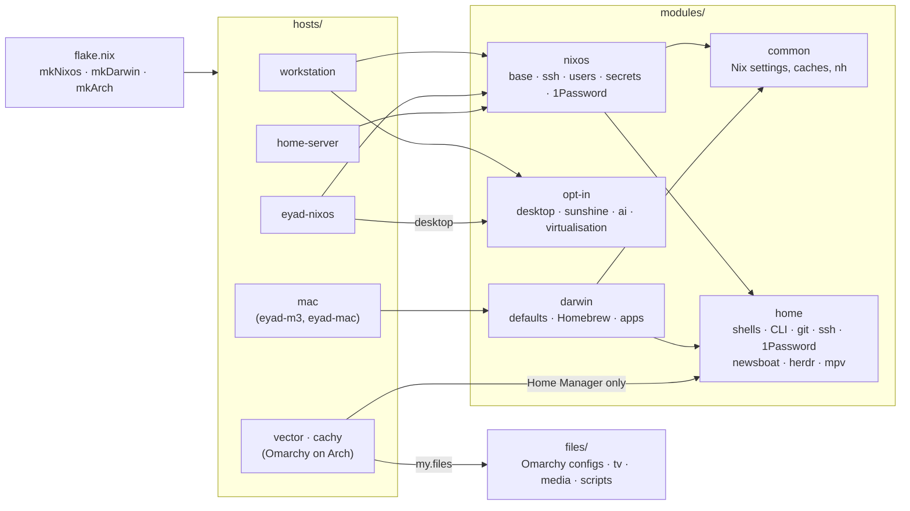

<div align="center">

# ❄️ dotfiles

**Every machine I own, in one flake.**

NixOS on the desk, Omarchy on Arch on the laptop I carry, nix-darwin on the Macs, Home
Manager underneath all of them. About 2,200 lines of Nix, and every setting lives in exactly one place.

[](https://github.com/eyadsibai/dotfiles/actions/workflows/check.yml)
[](https://nixos.org)
[](https://github.com/nix-darwin/nix-darwin)
[](https://github.com/olafkfreund/nixarchy)
[](#keys-live-in-1password)

</div>

---

## What this is

My personal configuration, not a framework. The desktop is [Omarchy](https://omarchy.org),
brought to NixOS by [nixarchy](https://github.com/olafkfreund/nixarchy), so the Nix machines
look and behave exactly like the Arch ones I sit at: same Hyprland keybinds, same bar, same
Tokyo Night. Everything in here is something I actually run, and the non-obvious parts are
commented with the reason.

## The machines

| Host | What it is | Notes |
|---|---|---|
| `workstation` | NixOS · Intel, 128 GB, RTX 4090 | The machine for all the dirty work: builds, Docker and libvirt, Ollama and LM Studio on the GPU, anything that needs cores or VRAM. Logs in at boot and locks itself, never sleeps, streams to the Macs over Sunshine. Used over Tailscale as much as at the desk. |
| `eyad-nixos` | NixOS · AMD ThinkPad | Same Omarchy desktop, plus the laptop quirks (kernel params this ThinkPad needed, power-profiles-daemon, trackpoint). |
| `eyad-m3`, `eyad-mac` | macOS · Apple Silicon | One configuration, two names. macOS defaults, Homebrew casks managed declaratively, a Linux builder VM, Rosetta. |
| `vector` | Omarchy on Arch · Dell XPS 14 (2026) | The laptop I carry. Arch and Omarchy own the system; Home Manager on its own adds the shell, CLI, git and the files in `files/`. |
| `cachy` | Omarchy on Arch · desktop | Reached remotely for development. Same as `vector`, with fish as the interactive shell. |
| `home-server` | NixOS | A skeleton with placeholder hardware. It will replace the Unraid box: backups and data, Plex, and the long list of homelab services that go with them. |

A DGX Spark is on its way and will take the large models off the workstation.

## How it's put together



```
flake.nix          inputs, mkNixos / mkDarwin / mkArch, the hosts, checks, dev shell
hosts/<name>/      hardware and what that machine is for; nothing shared lives here
modules/common/    Nix itself: caches, GC, nh, trusted users (both platforms)
modules/nixos/     every NixOS host gets default.nix; desktop, sunshine, ai and
                   virtualisation are opt-in by import
modules/darwin/    macOS defaults, Homebrew, Mac-only apps
modules/home/      Home Manager for every machine: shells, CLI, git, ssh, 1Password,
                   newsboat, herdr, mpv; firefox and the GUI apps only on Linux desktops
files/<package>/   plain config files mirroring ~, linked one by one (like stow); a host
                   lists the packages it wants, host-<name> last
omarchy-defaults/  the Omarchy default each file in files/ was last merged against
arch/<host>.packages  what an Arch machine has installed beyond Omarchy's own lists
secrets/           sops-encrypted, recipients in .sops.yaml
```

## Omarchy on Arch

`vector` and `cachy` are `homeConfigurations` (`eyad@vector`, `eyad@cachy`): Home Manager
without NixOS. Pacman installs the system, Omarchy and every program, the CLI tools and
shells included (`arch/<host>.packages`, `just arch-sync`); Home Manager writes only their
config. Where a module can't be told to skip its program, it gets a link to pacman's copy
(`modules/home/pacman-bin.nix`). Nix still installs its own tooling (nh, nil, nixd,
devenv) and Claude Code. mpv has one configuration everywhere; on Arch its binary and uosc
come from pacman, as Nix's mpv can't reach the GPU there.

The files in `files/` are linked to the checkout, not copied into the store, so editing
`~/.config/hypr/bindings.lua` edits the repo. Where one of them replaces an Omarchy default,
Omarchy updates can't silently overwrite it or leave it behind:

- Anything Omarchy writes into a linked file lands in the repo and shows up in `git diff`.
- `omarchy-defaults/` keeps the default each file was last merged against. After
  `omarchy update`, the post-update hook says when one of those defaults changed;
  `just omarchy-merge` applies only Omarchy's change to my version (a 3-way merge,
  conflicts marked), and refuses to run on a machine with an older Omarchy than the
  recorded one.

The one rule: **a setting has one home.** Anything needing root, hardware or a daemon goes
in `modules/nixos` or `modules/darwin`; everything else goes in Home Manager so every
machine gets it. A host file only says what makes that machine different. Optional
features are modules you import, and the few custom options live under `my.*`
(currently just `my.desktop.autoLogin`).

`files/media` is the living room: `media` drives the LG (`lgtv`) or Samsung (`samsungtv`) TV,
the Sonos through `soco-cli`, DLNA casting (`dlna`) and scenes in `~/.config/media/scenes/`.
The `eyad.media` Omarchy bar widget puts the same controls in the bar: TV power, Sonos
volume, playback, scenes, a remote and casting.

Casting is our own: `cast` is a small background service that owns the TV over DLNA.
It keeps a queue (or plays a whole folder in order), remembers where each video stopped,
plays links through yt-dlp, converts what the TV can't play with ffmpeg on the fly, and
sends subtitles (a `.srt`/`.ass`/`.vtt` next to the video, or a text track inside it).
The caster window (`media gui`, or "Open the caster…" in the panel) is the UI for it:
search `~/Videos`, `~/Downloads` and `~/Movies`, paste a link, and manage the queue.

## Decisions worth knowing

- **nixarchy follows main.** Main runs ahead of the release tags and carries fixes they
  don't have yet, so `just update` moves it with everything else. It's one maintainer's
  project: `just vm` before switching a NixOS machine to a big jump.
- **Only three binary caches are trusted:** `cache.nixos.org`, nix-community, and the
  community CUDA cache (through nixarchy's `cudaCache`, which only applies where the NVIDIA
  driver is on). Hyprland therefore comes from nixpkgs, not nixarchy's hyprwm input, and
  nixarchy's own small pieces build locally. A mirror sits in front of `cache.nixos.org`
  because the CDN route from home caps at ~1 MB/s and the mirror does 3–4× that, same
  signatures.
- **The workstation logs in at boot, then locks within a second.** Sunshine and gliff need
  a session to attach to after a reboot nobody is standing in front of. Sleep is disabled
  at the systemd level for the same reason: a remote machine that suspends is a brick.
- **Closed NVIDIA driver, LTS kernel.** The 4090 works with the open modules too, but this
  is what the machine has always run, and nixarchy's default of the newest kernel is one
  more thing to break on a machine I fix over SSH.
- **CUDA per package, never globally.** `nixpkgs.config.cudaSupport = true` only ever
  rebuilt Firefox and btop. Ollama gets `ollama-cuda`; btop gets an override.
- **Ollama listens on the tailnet, on its port only.** It has no authentication, so the
  firewall opens 11434 on `tailscale0` and nothing else. Same for Sunshine. nixarchy's
  trusted-tailnet option would open everything; this doesn't.
- **Rebuilds by hand, with a diff.** `nh os switch` shows what changes before activating,
  and `nh clean` keeps the last 10 generations and 7 days. No auto-update.
- **Homebrew with `cleanup = "zap"`.** On the Macs, anything not in `homebrew.nix` is
  removed on the next switch. The list *is* the Mac.
- **Toolchains belong to projects, not machines.** Each repo has a `devenv.nix`; the
  system ships `devenv`, direnv and the editors, nothing else.

## Keys live in 1Password

There are no private keys on any of these disks. The SSH agent, git authentication and
commit signing all go through the 1Password app, with two wrinkles for a machine that's
used over SSH:

- **The right agent for the session.** At the desk, SSH asks the local 1Password. Over SSH
  with a forwarded agent (`ssh -A`), the forwarded one wins, so the approval prompt appears
  on the screen I'm actually looking at. Over SSH *without* one, it falls back to the local
  app rather than having no key at all. One `Match exec` rule in
  `modules/home/onepassword.nix` decides.
- **Signing follows the same logic.** `op-ssh-sign` only talks to the local app, so the
  signer is a small wrapper that uses the forwarded agent (`ssh-keygen -Y sign`) when there
  is one. Commits made over `ssh -A` get approved on the laptop I'm typing on.

System secrets use [sops-nix](https://github.com/Mic92/sops-nix): age keys derived from each
host's SSH host key, plus a personal key backed up in 1Password. A machine decrypts its own
secrets at activation, into RAM, never into the store.

## Where nixarchy needed help

Fixed here, reported upstream. The workarounds live in `modules/nixos/desktop.nix` and
`modules/home/omarchy-apps.nix`, and go once nixarchy main has the fix.

| Gap | Fix | Upstream |
|---|---|---|
| Chromium starts without Omarchy's bundled extensions (copy-url, yt-dlp, WhatsApp): Omarchy enables them through a flags file that Arch's launcher reads and nixpkgs' doesn't. | Flags built into the Chromium the Omarchy package installs; native-messaging hosts re-registered at every activation via a stable `/run/current-system` path. | [#1491](https://github.com/olafkfreund/nixarchy/issues/1491), fixed in main; workaround removed |
| After an autologin boot the login keyring stays locked until some app asks for its password. | The lock screen's PAM service unlocks it, so the first unlock after boot opens the keyring. It stays encrypted. | [#1492](https://github.com/olafkfreund/nixarchy/issues/1492), fixed in main; workaround removed |
| After a switch, a changed prompt stays stale until the next login or theme change: omatheme copies the new `starship.toml` but doesn't re-render from it. | An activation step runs `hyprchroma shell` after omatheme's own. | omatheme#60 |
| Five Omarchy preinstalls aren't in nixarchy: Hype, Monologue, Signed, disktree, Superwhisper. | Packaged in `pkgs/` and installed for the user; Superwhisper also gets its user service and Omarchy bar panel. | not reported |

## Setting up an Arch machine

Omarchy first, then Nix from pacman, then Home Manager:

```bash
sudo pacman -S nix
git clone git@github.com:eyadsibai/dotfiles.git ~/dev/dotfiles
cd ~/dev/dotfiles
sudo cp arch/nix.conf /etc/nix/nix.conf    # flakes, plus the same caches as the Nix hosts
sudo systemctl enable --now nix-daemon.socket
sudo systemctl restart nix-daemon

cp -r hosts/vector hosts/$(hostname -s)    # new machine only: also add it to homeConfigurations
                                           # in flake.nix and give it a files/host-<name>
nix develop -c just switch                 # just and nh come from the dev shell until then
just arch-sync                             # pacman/AUR packages from arch/<host>.packages
```

Arch's `nix` no longer has a `nix-users` group; the daemon socket is open to every
local user, so there's no group to join. The first `switch` moves any file it would
replace aside as `*.hm-backup`: go through them (`find ~ -name '*.hm-backup'`) and move
anything worth keeping into the repo. Then open a new terminal for the Nix `PATH`,
`direnv allow` in the repo, and `systemctl --user enable --now tv-check.timer`.
Finally sign in to the 1Password app at the machine and turn on Settings → Developer →
"Use the SSH agent", or commits made at its own keyboard can't be signed.

## Day to day

Clone to `~/dev/dotfiles` (the path `nh` and Omarchy's Update menu expect), `direnv allow`
once for the dev shell, then:

| Command | Does |
|---|---|
| `just switch [host]` | build, show the package diff, activate (NixOS or macOS) |
| `just build [host]` | build and show the diff only |
| `just boot [host]` | NixOS: activate on next boot, for desktop or login changes |
| `just vm [host]` | NixOS: boot the exact configuration in a throwaway QEMU VM (no NVIDIA) |
| `just update [input...]` | update every flake input, or only the ones named |
| `just check` | `nix flake check`: evaluates every host, checks formatting |
| `just clean` | drop old generations, GC the store |
| `just secret <name>` | edit `secrets/<name>.yaml` |
| `just arch-preview` / `arch-backup` | Arch: list every file in `~` a switch would replace or add, with diffs / and archive the existing ones first |
| `just arch-sync` / `arch-save` | Arch: install what `arch/<host>.packages` lists / rewrite it from the machine |
| `just omarchy-check` / `omarchy-merge` | see which overridden Omarchy defaults changed upstream / merge them in |

`host` defaults to the current machine; on Arch, `switch` and `build` act on the Home Manager
configuration, and `switch` moves files it would replace aside as `*.hm-backup`. CI
evaluates every host on every push and runs `files/tv`'s tests when they change.

Small things in `modules/home/` I'd miss if they were gone:

- **newsboat** with 323 feeds and 495 YouTube channels (`newsboat-yt`), vim keys, and macros
  to send a link to mpv, yt-dlp or `download_arxiv`. The feed lists are plain files linked
  into `~/.config`, so `rssadd <url>` edits the repo.
- **herdr**, a tmux-style workspace manager for coding agents, with keys mirroring Omarchy's
  tmux config. Its config is linked from the repo too.
- **`x`** extracts any archive, **`wh`** says where a command really lives, **`getip`**,
  **`gitignore <lang>`**.
- About 50 git aliases (`l3`, `today`, `undo`, `ours`/`theirs`, `cleanup-local`, `unfuck`),
  and `gh:owner/repo` as a clone URL.
- Firefox with its extensions installed through policies and the privacy and telemetry
  prefs I want; mpv with the same h/j/k/l keys everywhere.

## When it breaks

Ten generations in the boot menu, `nh os rollback` over SSH, and `just vm` before anything
that touches the login path. The boot-menu editor is off on every host, so nobody at the
keyboard gets a root shell with `init=/bin/sh`.

## Built on

[nixpkgs](https://github.com/NixOS/nixpkgs) ·
[Home Manager](https://github.com/nix-community/home-manager) ·
[nix-darwin](https://github.com/nix-darwin/nix-darwin) ·
[nixarchy](https://github.com/olafkfreund/nixarchy) /
[Omarchy](https://github.com/basecamp/omarchy) ·
[sops-nix](https://github.com/Mic92/sops-nix) ·
[nix-index-database](https://github.com/nix-community/nix-index-database) ·
[nixos-hardware](https://github.com/NixOS/nixos-hardware) ·
[nh](https://github.com/nix-community/nh)

<div align="center">
<sub>Not meant to be used as-is: the hostnames, keys and feeds are mine. Borrow anything.</sub>
</div>
